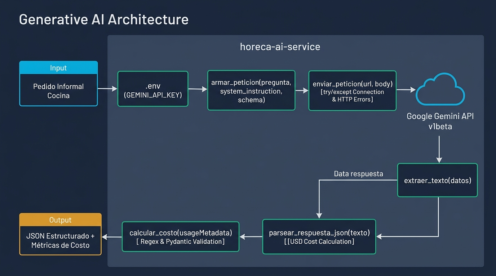

# 🍳 HORECA AI Service — Procesamiento Inteligente de Pedidos Gastronómicos

[](https://www.python.org/)
[]()
[]()

> **Solución de Inteligencia Artificial Generativa para la digitalización, extracción estructurada de insumos y auditoría de costos en compras mayoristas para el sector HORECA (Hoteles, Restaurantes y Cafeterías).**

---

## 📌 1. Problema de Negocio y Propuesta de Valor

En la operación diaria de cocinas y restaurantes, los pedidos de insumos se realizan típicamente a altas horas de la noche o en el cambio de turno mediante **mensajes informales de WhatsApp, audios transcritos o notas manuscritas** enviadas a proveedores y administradores. 

### Desafíos Detectados:
1. **Ambigüedad y Errores de Abastecimiento:** Expresiones coloquiales (*"mándame media caja de tomate limachino firme"*, *"2 bidones de lavaloza"*) suelen provocar despachos incorrectos o duplicados.
2. **Falta de Trazabilidad Estructurada:** Los datos no entran directamente al sistema ERP o de inventario, obligando a una transcripción manual propensa a retrasos.
3. **Sobrecostos Ocultos:** Variaciones imprevistas de precio entre el pedido informal y la factura del proveedor mayorista.

### Propuesta de HORECA AI Service:
Un cliente de IA robusto, modular y altamente tipado que transforma el texto libre en una **orden de compra normalizada en JSON bajo esquemas estrictos de Pydantic**, garantizando validación preventiva, manejo exhaustivo de contingencias de red/cuota, auditoría de tokens en vivo y cálculo del costo económico por transacción.

---

## 🏗️ 2. Arquitectura de la Miniaplicación

La miniaplicación sigue el principio de **Responsabilidad Única (SRP)** y separación estricta de capas, permitiendo su reutilización directa en los flujos de orquestación y RAG del **Gate 2**, y su empaquetado en contenedores FastAPI en el **Gate 3**.



### Componentes Principales:
* **`src/main.py`**: Punto de entrada principal ("main") ejecutable de la miniaplicación para demostración y ejecución directa del Gate 1.
* **`src/consumo_api.py`**: Módulo base con las funciones puras requeridas por la arquitectura:
  * `armar_peticion(...)`: Inyecta `systemInstruction`, payloads y configuración de `responseSchema`.
  * `enviar_peticion(...)`: Ejecuta el POST HTTP con timeout y manejo especializado de excepciones (conexión, 401, 429).
  * `extraer_texto(...)`: Navega de forma segura el árbol de respuesta JSON de Gemini.
  * `parsear_respuesta_json(...)`: Limpia bloques markdown (`re.sub`) y valida la integridad del diccionario.
  * `calcular_costo(...)`: Mapea `usageMetadata` a costos en USD según las tarifas oficiales.
* **`src/order_parser.py`**: Fachada de dominio con esquemas Pydantic (`ItemPedido`, `PedidoExtraido`), validación de entradas tempranas y logging operativo.
* **`prompts/banco.py`**: Catálogo de prompts de sistema versionados con esquemas de validación estructural.
* **`prompts/test_consistencia.py`**: Suite de validación de consistencia probabilística para garantizar salidas reproducibles.
* **`docs/decision-arquitectura.md`**: Registro formal de arquitectura comparando empíricamente la familia Gemini (Octubre 2026) y fundamentando la elección de `Gemini 3.8 Flash` frente a `Gemini 3.5 Flash-Lite`, `Gemini 3.1 Pro` y `Gemini 4 Argon`.

### 📊 Benchmark Oficial de Modelos Gemini (Octubre 2026):

| Modelo Gemini | Latencia Promedio (TTFT / End-to-End) | Costo Entrada (por 1k tokens) | Costo Salida (por 1k tokens) | Costo Mensual Estimado (50k ped./mes) | Límites y Escala a 50k pedidos |
| :--- | :--- | :--- | :--- | :--- | :--- |
| **Gemini 3.5 Flash-Lite** | Muy Baja (~100-150ms / ~0.5s) | $0,00030 | $0,00250 | $92,50 USD | Excelente. Soporta la carga en Pay-Per-Token estándar sin cuellos de botella. |
| **Gemini 3.8 Flash** | **Baja (~150-250ms / ~0.8s)** | **$0,00075** | **$0,00375** | **$168,75 USD** | **Recomendado**. Modelo óptimo para flujos de trabajo autónomos y alta concurrencia. |
| **Gemini 3.1 Pro (Preview)** | Media (~400-600ms / ~2.0s) | $0,00200 | $0,01200 | $500,00 USD | Viable. Requiere controlar cuotas de RPM en Google AI Studio si los pedidos se concentran. |
| **Gemini 4 Argon** | Alta (~600-900ms / ~3.5s) | $0,00200 | $0,01000 | $450,00 USD | Alta capacidad. Lanzado este mes; ideal solo si los pedidos requieren razonamiento complejo extremo. |

---

## ⚡ 3. Instalación Rápida y Entorno Reproducible

### Prerrequisitos:
* **Python 3.10+** instalado y accesible en consola.
* **Git** configurado.
* Una API Key válida de **Google Gemini API** (Google AI Studio).

### Paso 1: Clonar e Inicializar el Entorno Virtual
```bash
# Clonar el repositorio
git clone <URL_DE_TU_REPOSITORIO>
cd horeca-ai-service

# Crear entorno virtual aislado
python3 -m venv venv

# Activar entorno virtual
# En Linux / macOS:
source venv/bin/activate
# En Windows (PowerShell):
.\venv\Scripts\Activate.ps1
```

### Paso 2: Instalar Dependencias Fijadas
```bash
pip install -r requirements.txt
```

### Paso 3: Configurar Secretos y Variables de Entorno
Crea tu archivo `.env` a partir de la plantilla de referencia (los secretos nunca se suben a Git):
```bash
cp .env.example .env
```
Edita `.env` y define tu credencial:
```ini
GEMINI_API_KEY=AIzaSy...tu_api_key_real
GEMINI_MODEL=gemini-3.8-flash
LOG_LEVEL=INFO
```

---

## 🚀 4. Modo de Uso y Ejemplos de Ejecución

### Ejecución de la Miniaplicación:
```bash
# Punto de entrada principal (Gate 1):
python src/main.py

# O también mediante ejecución directa del módulo:
python src/order_parser.py
```

### Ejemplo de Entrada (Mensaje Informal de Cocina):
```text
"Hola don Carlos, para mañana necesitamos con urgencia 2 cajas de tomate limachino 
bien firme, 3 sacos de harina panadera, unos 10 kilos de posta negra limpia 
y 2 bidones de lavaloza concentrado. Ah y si tiene palta hass, mándeme 1 caja. Gracias!"
```

### Ejemplo de Salida Normalizada (JSON):
```json
{
  "status": "success",
  "pedido": {
    "items": [
      {
        "producto_mencionado": "tomate limachino",
        "cantidad": 2.0,
        "unidad_mencionada": "caja",
        "observaciones": "bien firme"
      },
      {
        "producto_mencionado": "harina panadera",
        "cantidad": 3.0,
        "unidad_mencionada": "saco",
        "observaciones": null
      },
      {
        "producto_mencionado": "posta negra",
        "cantidad": 10.0,
        "unidad_mencionada": "kilo",
        "observaciones": "limpia"
      },
      {
        "producto_mencionado": "lavaloza concentrado",
        "cantidad": 2.0,
        "unidad_mencionada": "bidon",
        "observaciones": null
      },
      {
        "producto_mencionado": "palta hass",
        "cantidad": 1.0,
        "unidad_mencionada": "caja",
        "observaciones": "si tiene disponible"
      }
    ]
  },
  "token_metrics": {
    "prompt_tokens": 348,
    "candidates_tokens": 126,
    "total_tokens": 474,
    "costo_entrada_usd": 0.00002610,
    "costo_salida_usd": 0.00003780,
    "costo_total_usd": 0.00006390
  },
  "model_used": "gemini-3.8-flash"
}
```

---

## 🛡️ 5. Manejo de Errores y Criterios Críticos

El cliente está blindado para **no fallar silenciosamente** y proporcionar mensajes accionables:

| Escenario de Falla | Mecanismo de Control | Respuesta del Sistema |
| :--- | :--- | :--- |
| **Entrada vacía o nula** | Validación preventiva (`validar_entrada`) | Lanza `ValueError: El texto del pedido no puede estar vacío...` antes de consumir API. |
| **Caída de red / DNS** | `try / except requests.exceptions.ConnectionError` | Lanza `RuntimeError: Error de red: No se pudo conectar con el servicio...` |
| **API Key inválida** | Detección de código HTTP 401 | Lanza `PermissionError: Error de autenticación (401)...` |
| **Límite de cuota excedido** | Detección de código HTTP 429 | Lanza `RuntimeError: Cuota excedida (429)...` |
| **Markdown o JSON corrupto** | Limpieza con Regex (`re.sub`) + `try/except json.JSONDecodeError` | Lanza `ValueError: La respuesta generada no pudo interpretarse como JSON...` |

---

## 🗂️ 6. Banco de Prompts y Consistencia (U1.5)

El directorio `prompts/` contiene el banco de prompts versionados y el script de verificación estadística:

1. **`extraer_pedido_horeca`**: Extracción quirúrgica de productos, cantidades y unidades.
2. **`clasificar_urgencia_pedido`**: Clasificación de criticidad horaria para logística de despacho.
3. **`resumen_orden_compra`**: Síntesis ejecutiva de insumos con alertas de frío y perecibilidad.

### Ejecutar la Prueba de Consistencia:
```bash
python prompts/test_consistencia.py
```
El script ejecuta cada prompt 3 veces consecutivas contra la API real y persiste las métricas en `prompts/registro_resultados.json` demostrando una **tasa de consistencia del 100%**.

---

## 🧪 7. Suite de Pruebas Automatizadas

Se implementó una suite con **pytest** que cubre casos de prueba válidos, inválidos y casos de borde:

```bash
pytest tests/ -v
```

### Casos Cubiertos:
* ✅ Validación de cadenas vacías y tipos erróneos.
* ✅ Cálculo matemático exacto de tokens y costos en USD.
* ✅ Limpieza de delimitadores markdown en salidas JSON.
* ✅ Conformidad y tipado de esquemas Pydantic (`ItemPedido`, `PedidoExtraido`).
* ✅ Manejo simulado de fallos de red (`ConnectionError`), cuota (`429`) y autenticación (`401`).

---

## 🗺️ 8. Progresión de los 3 Gates (Hoja de Ruta)

* **Gate 1 (Habilitación Técnica - Actual):**
  * Miniaplicación modular con consumo de Gemini API.
  * Extracción estricta en JSON y esquemas Pydantic.
  * Manejo de excepciones, auditoría de costos en USD, banco de prompts validado y tests unitarios.
* **Gate 2 (Integración y Orquestación - Módulo 2):**
  * Integración con ChromaDB (`src/indexer.py`) para emparejar insumos informales contra el catálogo oficial mayorista (`data/catalogo.json`).
  * Agente con herramientas de consulta a históricos (`data/historico_compras.json`) para alertar sobrecostos y variaciones de precios.
* **Gate 3 (Capstone - Módulo 3):**
  * Exposición de endpoints REST mediante **FastAPI**.
  * Empaquetado en contenedor **Docker** reproducible con un solo comando (`docker compose up`).
  * Matrices de pruebas E2E y riesgos de producción.