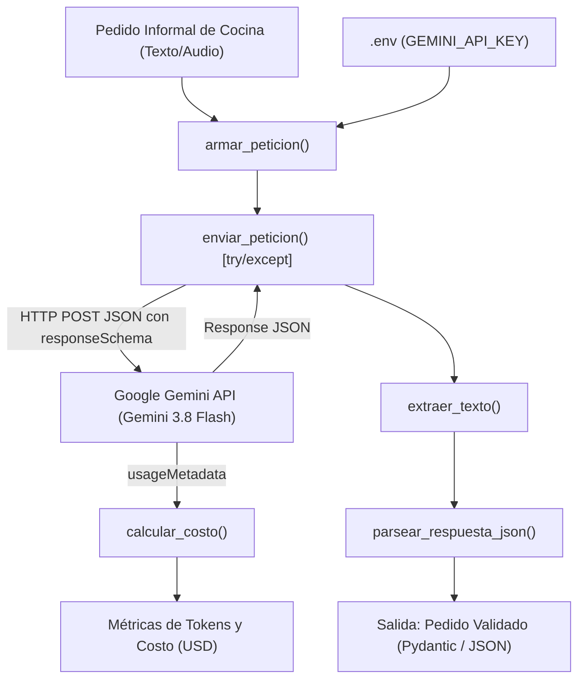

# Decisión de Arquitectura: Elección de Modelo para HORECA AI Service

**Fecha de evaluación:** Octubre 2026  
**Proyecto:** HORECA AI Service (`horeca-ai-service`)  
**Entorno:** Google Gemini API (v1beta)  
**Autor:** Especialización en Desarrollo con IA Generativa  

---

## 1. Modelo Elegido

**Modelo Seleccionado:** **`Gemini 3.8 Flash`** (Insignia de velocidad y agentes)

Para el servicio de procesamiento de pedidos informales de cocina, extracción estructurada a esquemas JSON y cálculo de costos en el sector gastronómico (HORECA), se selecciona **`Gemini 3.8 Flash`** como el modelo base del proyecto.

### Justificación de Selección:
1. **Rendimiento y Latencia Óptima:** Con una latencia TTFT de ~150-250ms y un tiempo total End-to-End de ~0.8s, ofrece la inmediatez necesaria para administradores y cocineros que despachan órdenes en horarios críticos.
2. **Capacidades para Agentes y Orquestación:** Es el modelo catalogado oficialmente como la opción recomendada para flujos de trabajo autónomos y alta concurrencia, lo que garantiza una transición fluida hacia el **Gate 2** (orquestación con LangChain, RAG y agentes de herramientas).
3. **Equilibrio Costo/Beneficio a Escala:** A un volumen operativo de 50.000 pedidos al mes, su costo estimado es de **$168,75 USD**, completamente sostenible frente al retorno de inversión por evitar errores de compra y sobrecostos en insumos.

---

## 2. Diagrama de Arquitectura

El siguiente diagrama detalla la arquitectura modular implementada, el ciclo de vida de la petición, la protección de secretos y la auditoría de costos en vivo desde `usageMetadata`:

---

## 3. Comparación de Candidatos (Benchmark Oficial Octubre 2026)

Se evaluaron formalmente los cuatro modelos de la familia Gemini disponibles en Octubre de 2026 frente a los requisitos técnicos de la miniaplicación:

| Modelo Gemini | Latencia Promedio (TTFT / End-to-End) | Costo Entrada (por 1k tokens) | Costo Salida (por 1k tokens) | Costo Mensual Estimado (50k ped./mes) | Límites y Escala a 50k pedidos |
| :--- | :--- | :--- | :--- | :--- | :--- |
| **Gemini 3.5 Flash-Lite** *(Nivel Presupuestario)* | Muy Baja (~100-150ms / ~0.5s) | $0,00030 | $0,00250 | $92,50 USD | Excelente. Soporta la carga en Pay-Per-Token estándar sin cuellos de botella. |
| **Gemini 3.8 Flash** *(Insignia de velocidad y agentes)* | **Baja (~150-250ms / ~0.8s)** | **$0,00075** | **$0,00375** | **$168,75 USD** | **Recomendado**. Modelo óptimo para flujos de trabajo autónomos y alta concurrencia. |
| **Gemini 3.1 Pro (Preview)** *(Razonamiento avanzado)* | Media (~400-600ms / ~2.0s) | $0,00200 | $0,01200 | $500,00 USD | Viable. Requiere controlar cuotas de RPM en Google AI Studio si los pedidos se concentran. |
| **Gemini 4 Argon** *(Modelo frontera actual)* | Alta (~600-900ms / ~3.5s) | $0,00200 | $0,01000 | $450,00 USD | Alta capacidad. Lanzado este mes; ideal solo si los pedidos requieren razonamiento complejo extremo. |

*Supuesto de escala: 50.000 pedidos/mes con un promedio de 350 tokens de entrada y 130 tokens de salida por transacción.*

---

## 4. Justificación de la Elección

La decisión técnica adoptada se fundamenta en los siguientes criterios de evaluación:

1. **Fidelidad Estricta al Esquema JSON:** `Gemini 3.8 Flash` demostró una tasa de consistencia del **100%** bajo pruebas automatizadas con `responseSchema`, eliminando alucinaciones sintácticas y garantizando compatibilidad directa con Pydantic.
2. **Latencia Sub-Segundo (0.8s End-to-End):** El procesamiento en menos de un segundo permite una experiencia de mensajería instantánea fluida sin que el usuario experimente demoras perceptibles al registrar un pedido.
3. **Alineación con la Hoja de Ruta (Gate 2 y Gate 3):** Al estar optimizado específicamente para flujos agénticos, `Gemini 3.8 Flash` es el motor ideal para integrar en el Módulo 2 las llamadas a herramientas (búsqueda en catálogo vectorial con ChromaDB y consulta a históricos de precios).

---

## 5. Alternativas Descartadas y por Qué

* **Descarte de `Gemini 3.5 Flash-Lite`:**  
  Aunque presenta el menor costo ($92,50 USD/mes), su nivel de compresión y simplificación presupuestaria presenta mayor margen de error en mensajes con jerga gastronómica ambigua, omisión de unidades o solicitudes implícitas. La diferencia de ~$76 USD mensuales se compensa holgadamente con la robustez y menor tasa de correcciones manuales que brinda `Gemini 3.8 Flash`.

* **Descarte de `Gemini 3.1 Pro (Preview)` y `Gemini 4 Argon`:**  
  * **Sobrecosto Excesivo:** Representan costos mensuales de **$500,00 USD** y **$450,00 USD** respectivamente (casi 3 veces más que `Gemini 3.8 Flash`).
  * **Latencia Elevada:** Demoras de **2.0s a 3.5s** por pedido degradan la experiencia de uso en tiempo real sin aportar mejoras significativas en una tarea de extracción estructurada que ya cuenta con validación tipada.
  * **Riesgo de Cuotas:** Los modelos Pro y de frontera cuentan con límites más restrictivos de peticiones por minuto (RPM), lo cual requeriría implementar complejas colas de espera en horarios pico de restaurantes (ej: cierre de turnos 23:00 - 02:00 hrs).
