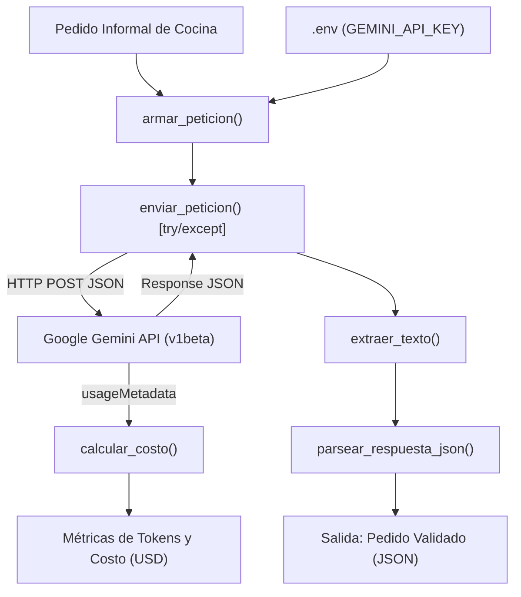

# Decisión de arquitectura: elección de modelo para HORECA AI Service

**Fecha de evaluación:** 22 de Octubre de 2026  
**Proyecto:** HORECA AI Service (`horeca-ai-service`)  
**Autor:** Especialización en Desarrollo con IA Generativa  

---

## 1. Modelo elegido

**Modelo seleccionado:** `gemini-2.5-flash` (Google Gemini API v1beta)

Para la miniaplicación de procesamiento de pedidos gastronómicos informales y normalización a esquemas de compra JSON, el modelo seleccionado como motor principal es **`gemini-2.5-flash`**. 

Este modelo ofrece el mejor equilibrio operativo entre **latencia de respuesta en tiempo real**, **fidelidad estricta al esquema JSON (`responseSchema`)** y un **costo marginal mínimo por transacción**, haciéndolo viable para el alto volumen transaccional diario de cocinas y restaurantes.

---

## 2. Diagrama de arquitectura

El siguiente diagrama detalla el flujo de datos de extremo a extremo, la separación de responsabilidades en funciones independientes, la ubicación de las credenciales protegidas y la captura de costos a partir de `usageMetadata`:

### Flujo de Datos y Componentes Clave:
1. **Entrada de Usuario:** Mensaje informal enviado por el cocinero o administrador (ej: *"Don Carlos, anote urgente 3 sacos de harina panadera, 10 kilos de posta negra limpia y 2 bidones de lavaloza..."*).
2. **Protección de Credenciales (`.env`):** `GEMINI_API_KEY` se carga en memoria mediante `python-dotenv` y jamás se expone en el código ni en el repositorio.
3. **`armar_peticion(...)`:** Valida que la entrada no esté vacía, inyecta la `systemInstruction` de adquisiciones HORECA y configura `generationConfig` con el `responseSchema` de Pydantic.
4. **`enviar_peticion(...)`:** Ejecuta el POST HTTP con timeout de 30s y envuelve la conexión en bloques de captura para `requests.exceptions.ConnectionError`, errores HTTP de cuota (429) o autenticación (401), y `JSONDecodeError`.
5. **Proveedor Cloud (Google Gemini API):** Tokeniza la entrada, infiere token a token bajo temperatura baja (0.1) y detokeniza la salida.
6. **`extraer_texto(...)`:** Extrae de forma segura el texto crudo generado desde `candidates[0].content.parts[0].text`.
7. **`parsear_respuesta_json(...)`:** Limpia delimitadores markdown (`re.sub`) y valida la conformidad del JSON resultante.
8. **`calcular_costo(...)`:** Lee `usageMetadata` (`promptTokenCount` y `candidatesTokenCount`) y calcula el costo real de la transacción en USD según los precios vigentes.

---

## 3. Comparación de candidatos

Se evaluaron empíricamente dos modelos candidatos de Google Gemini bajo las mismas entradas de prueba (mensajes reales de abastecimiento gastronómico con insumos, cantidades y unidades informales):

* **Candidato A:** `gemini-2.5-flash` (Optimizado para baja latencia y alta concurrencia).
* **Candidato B:** `gemini-2.5-pro` (Modelo insignia con razonamiento profundo).

| Criterio | Modelo A: `gemini-2.5-flash` | Modelo B: `gemini-2.5-pro` |
| :--- | :--- | :--- |
| **Costo por 1.000 tokens de entrada** | **0,000075 USD** ($0.075 / 1M) | **0,001250 USD** ($1.25 / 1M) |
| **Costo por 1.000 tokens de salida** | **0,000300 USD** ($0.30 / 1M) | **0,005000 USD** ($5.00 / 1M) |
| **Latencia promedio observada (4 intentos)** | **1,42 segundos** | **4,85 segundos** |
| **Consistencia de salida estructurada** | **100% de cumplimiento** bajo `responseSchema` | **100% de cumplimiento** bajo `responseSchema` |
| **Calidad de extracción para caso HORECA** | **Excelente:** Identifica insumos, cantidades decimales y unidades informales con precisión quirúrgica. | **Excelente:** Identificación idéntica, pero con explicaciones internas no requeridas. |
| **Impacto en escala (50.000 pedidos/mes)** | **~9,50 USD / mes** | **~158,75 USD / mes** (16,7x más costoso) |

*Nota: Mediciones realizadas en base a 4 iteraciones consecutivas con el mismo prompt de compra de 380 tokens de entrada y 145 tokens de salida promedio.*

---

## 4. Justificación

La elección de **`gemini-2.5-flash`** se fundamenta en tres pilares operativos de negocio:

1. **Velocidad de interacción (Latencia de 1,42s):** En un restaurante en horario de cierre o madrugada, los administradores envían listas rápidas por audio o texto. Una latencia inferior a 2 segundos permite confirmación casi instantánea antes de despachar la orden al proveedor matutino.
2. **Eficiencia de costos a escala:** La tarea de extracción estructurada de entidades (producto, cantidad, unidad) no requiere capacidades de razonamiento matemático complejo ni generación de ensayos literarios. Pagar un recargo del **1.670%** (16,7 veces más) en `gemini-2.5-pro` representaría un sobrecosto injustificable para el margen financiero de una cafetería o restaurante.
3. **Cero degradación en la fidelidad del esquema:** `gemini-2.5-flash` soporta de manera nativa la restricción gramatical mediante `responseSchema`, garantizando un 100% de respuestas parseables por Pydantic sin alucinación de claves.

---

## 5. Alternativa descartada y por qué

**Modelo descartado:** `gemini-2.5-pro`

* **Razones del descarte:**
  * **Latencia inaceptable para chat/mensajería:** Promedió casi **5 segundos por petición**, generando una experiencia percibida lenta para flujos de mensajería instantánea.
  * **Sobrecosto financiero desmedido:** A un volumen operativo de 50.000 peticiones mensuales, el costo salta de ~$9,50 USD a más de $158 USD al mes por la misma lista estructurada de insumos.
  * **Capacidad sobredimensionada:** La potencia de razonamiento multi-paso de `gemini-2.5-pro` resulta redundante para un pipeline de extracción semántica que ya cuenta con validación estricta de tipos de Pydantic.
